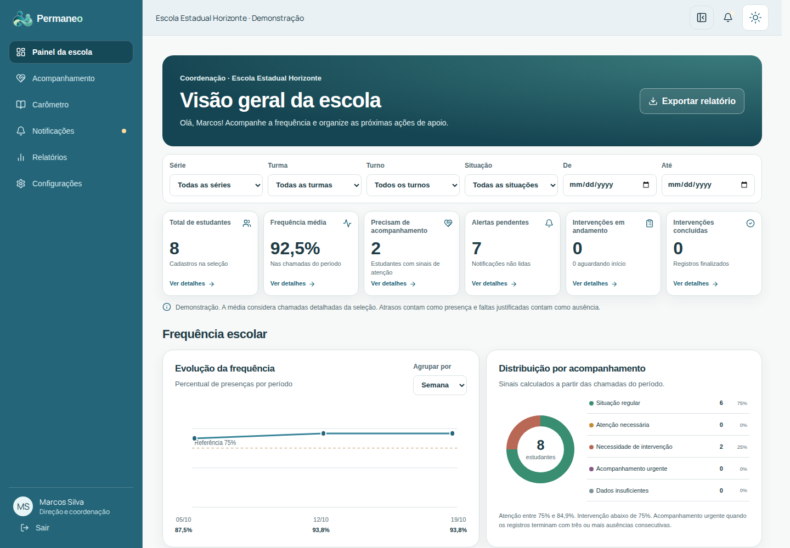
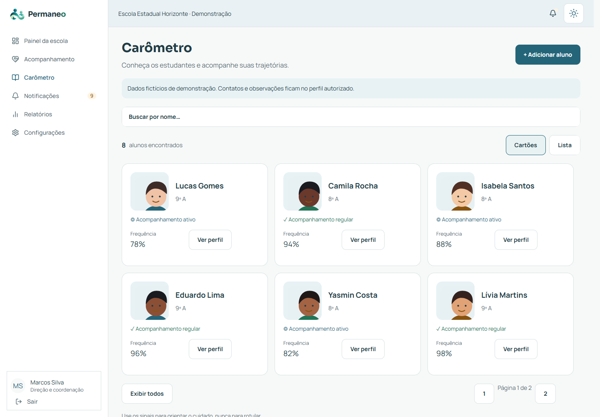
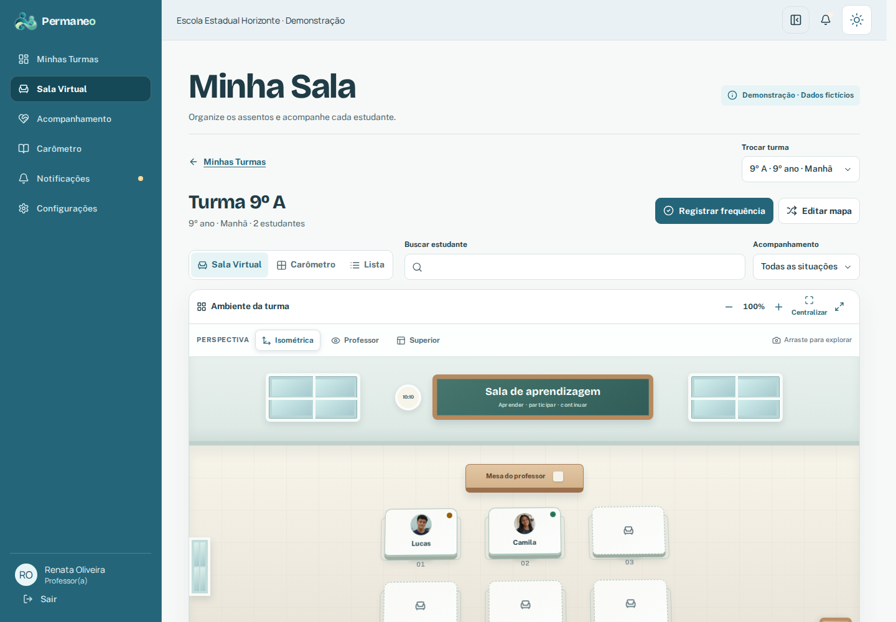
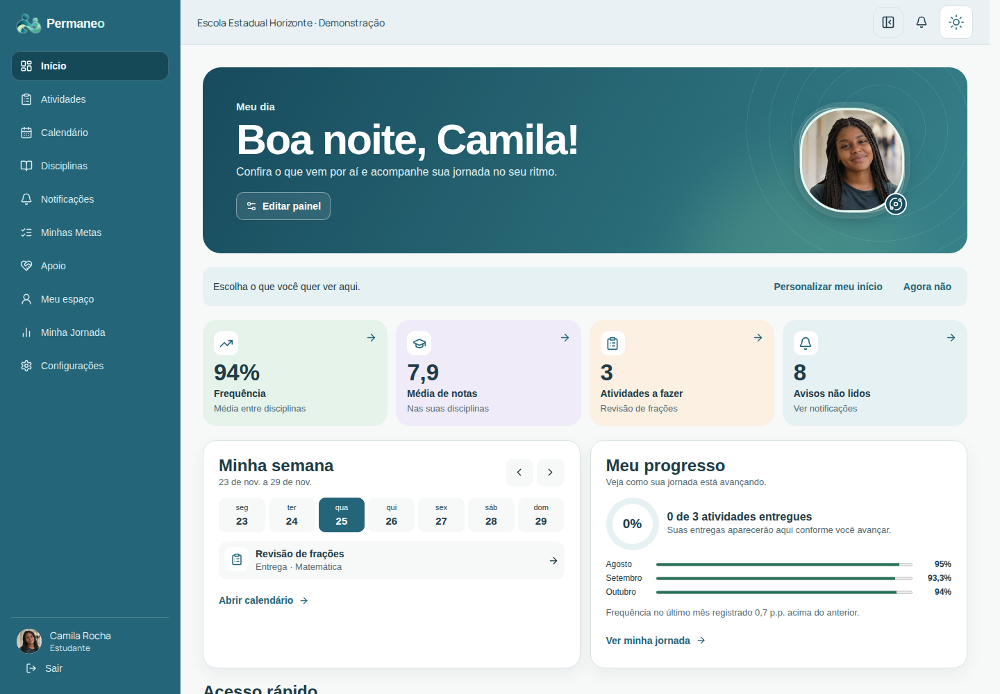
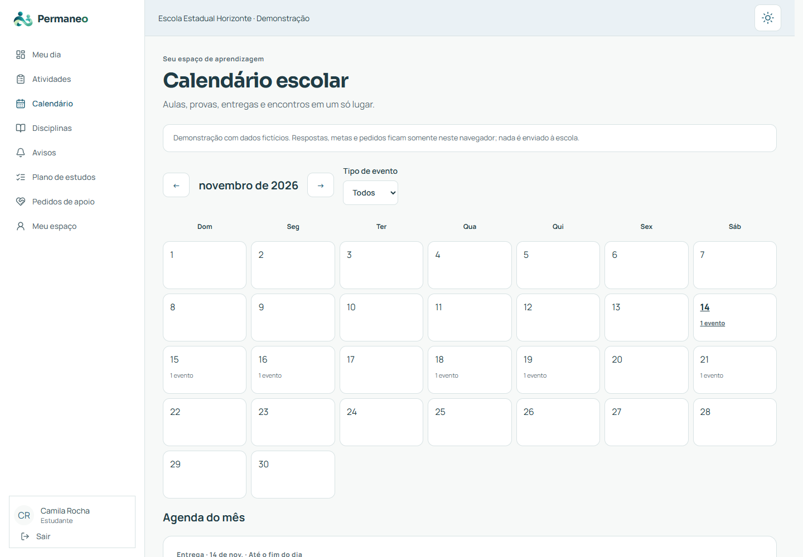
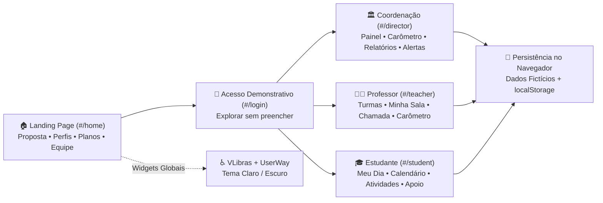

<div align="center">

<a href="https://permaneo-ofc.vercel.app/#/home" title="Abrir demonstração interativa do Permaneo">
  
</a>

<sub>🎬 <b>Sequência animada em 7 capítulos (28s em loop · SVG puro)</b> — clique no player acima para abrir a demonstração interativa.</sub>

<br /><br />

[](https://github.com/PermaneoOFC/demo-repository/actions/workflows/validacao.yml)


-227457?style=flat-square&logo=node.js&logoColor=white)

<br />

[](https://permaneo-ofc.vercel.app/#/home)
[](https://permaneo-ofc.vercel.app/links/)
[](https://github.com/iagosm-oliveira/padroes-de-commits)

<br />

[Sobre](#-sobre-o-projeto) •
[Tour pelos Perfis](#-tour-interativo-pelos-perfis) •
[Arquitetura](#-jornada-e-arquitetura) •
[Como Rodar](#-como-rodar-localmente) •
[Organização](#-organização-do-repositório) •
[IA & Commits](#-contexto-para-ia-e-padrões-de-commit) •
[Equipe](#-equipe)

<br />


</div>


## 💡 Sobre o Projeto

O **Permaneo** é um protótipo web de acompanhamento escolar criado para apoiar a **prevenção da evasão**. A proposta é reunir contexto de frequência, desempenho e histórico pedagógico em uma interface acessível e acolhedora, ajudando a equipe escolar a perceber sinais de afastamento cedo — antes que o estudante deixe a escola.

> [!NOTE]
> **Escopo da demonstração:** A versão atual utiliza **dados fictícios** e persistência local no navegador (`localStorage`). A escolha de perfil no login (**Explorar sem preencher**) simula a navegação entre papéis da comunidade escolar — não representa autenticação real nem envio de dados institucionais.

### Diretrizes e Propósito

| Pilar | Diretriz |
| --- | --- |
| 🎯 **Missão** | Ajudar as escolas a identificar sinais de afastamento e organizar o apoio à permanência dos estudantes. |
| 🔭 **Visão** | Tornar o acompanhamento escolar mais claro e acessível para coordenação, professores e estudantes. |
| 💚 **Valores** | Acolhimento, acessibilidade, clareza e cuidado com os dados escolares. |
| 🛡️ **Princípio** | Apoiar conversas e intervenções pedagógicas — sem rotular estudantes nem automatizar julgamentos. |

<br />

## 🧭 Tour Interativo pelos Perfis

Clique em cada perfil abaixo para expandir as capturas reais da plataforma e explorar o que já pode ser testado na demonstração:

<details open>
<summary><b>🏛️ Coordenação &amp; Direção</b> — Visão geral da escola, Carômetro, alertas, relatórios e configurações</summary>

<br />

- **Visão Geral (`#/director`):** indicadores consolidados por turma, pendências prioritárias e atalhos para intervenção.
- **Carômetro (`#/carometroManagement`):** ficha visual com histórico do estudante, observações docentes e filtro por turma/status.
- **Acompanhamento, Alertas e Relatórios (`#/directorFollowup`, `#/directorNotifications`, `#/reports`):** registro de ocorrências locais, filtros por severidade/categoria e exportação demonstrativa em CSV.

<p align="center">
  
  &nbsp;
  
</p>

</details>

<details>
<summary><b>👩‍🏫 Professor</b> — Minhas Turmas, Minha Sala interativa, chamada, Carômetro e notificações</summary>

<br />

- **Minhas Turmas &amp; Minha Sala (`#/teacher`, `#/teacherRoom`):** planta visual da sala com zoom, modo alternativo em lista acessível por teclado e edição de assentos (mouse, toque e teclado) com carteiras livres e desfazer/refazer/cancelar.
- **Chamada &amp; Observações (`#/teacherAttendance`):** registro local de presença e anotações pedagógicas por estudante persistidas no navegador.
- **Notificações &amp; Preferências (`#/teacherNotifications`, `#/teacherSettings`):** filtros operacionais e ajustes visuais alinhados ao tema claro/escuro.

<p align="center">
  
</p>

</details>

<details>
<summary><b>🎓 Estudante</b> — Meu dia, atividades, calendário, disciplinas, avisos, plano de estudos e pedidos de apoio</summary>

<br />

- **Portal completo (8 telas):** `#/student` (e links legados como `#student`), `#/studentActivities`, `#/studentCalendar`, `#/studentSubjects`, `#/studentNotices`, `#/studentPlan`, `#/studentSupport` e `#/studentSpace`.
- **Acompanhamento próprio:** frequência demonstrativa, metas pessoais, entrega simulada de atividades e solicitação de apoio pedagógico com persistência local no navegador (nada é enviado à escola).

<p align="center">
  
  &nbsp;
  
</p>

</details>

<details>
<summary><b>♿ Acessibilidade, Planos Demonstrativos e Recursos Recuperados</b></summary>

<br />

- **Temas &amp; Inclusão:** alternância entre temas claro e escuro, foco visível, navegação por teclado, suporte a movimento reduzido e integração única de **VLibras** + **UserWay** fora da árvore React ([`Documentacao/Acessibilidade.md`](Documentacao/Acessibilidade.md)).
- **Seção Comercial (Landing Page):** calculadora demonstrativa de planos (**Mensal:** R$ 249,00 + R$ 6,90/aluno/mês · **Anual equivalente:** R$ 210,00 + R$ 5,90/aluno/mês · acima de 1.000 alunos sob medida) que gera resumo local sem cobrança nem envio externo ([`Documentacao/planos-permaneo.md`](Documentacao/planos-permaneo.md)).
- **Recuperação Completa:** histórico detalhado das entregas integradas em [`Documentacao/Restauracao.md`](Documentacao/Restauracao.md).

</details>

<br />


## 🔄 Jornada e Arquitetura



<br />

## 🚀 Como Rodar Localmente

Requer **Node.js `>=20.19.0`** (recomendado **Node 22 LTS**).

<p align="center">
  
</p>

<details open>
<summary><b>🪟 Windows (PowerShell)</b></summary>

```powershell
cd permaneo-app
npm.cmd ci
npm.cmd run dev
```

Abra a URL local exibida pelo Vite (ex.: `http://localhost:5173`).

</details>

<details>
<summary><b>🐧 Linux / 🍎 macOS (Terminal)</b></summary>

```bash
cd permaneo-app
npm ci
npm run dev
```

Abra a URL local exibida pelo Vite (ex.: `http://localhost:5173`).

</details>

<details>
<summary><b>🧪 Build e Suítes de Validação (12 scripts)</b></summary>

Na pasta `permaneo-app`:

```bash
npm test              # Testes gerais do frontend
npm run build         # Build de produção em dist/
npm run preview       # Pré-visualização local do build
```

| Comando | Cobertura |
| --- | --- |
| `npm run test:browser` | Smoke e fluxos principais no navegador (requer Google Chrome) |
| `npm run test:accessibility` | Requisitos de acessibilidade |
| `npm run test:student` | Fluxos e 8 telas da área do estudante |
| `npm run test:shell` | Shell compartilhado e navegação |
| `npm run test:profile` | Perfis e troca de papéis |
| `npm run test:classroom` | Sala virtual, assentos e persistência local |
| `npm run test:widgets` | Posicionamento e carregamento de VLibras / UserWay |
| `npm run test:pricing` | Cálculos em centavos da calculadora comercial |
| `npm run test:commercial` | Fluxo comercial no navegador |
| `npm run test:portraits` | Carômetro e retratos |
| `npm run test:redesign` | Validação do redesign de experiência |

</details>

<br />

## 📂 Organização do Repositório

| Módulo / Arquivo | Conteúdo |
| --- | --- |
| [`permaneo-app`](permaneo-app/) | Aplicação React 18, JavaScript, Vite 6 e CSS Modules |
| [`Documentacao`](Documentacao/) | Pesquisa de campo, jornada, arquitetura, tecnologias, acessibilidade e planos |
| [`AGENTS.md`](AGENTS.md) | Instruções operacionais, limites de produto e regras para agentes de IA |
| [`PROJECT_CONTEXT.md`](PROJECT_CONTEXT.md) | Contexto mestre, histórico recente e mapa técnico do Permaneo |
| [`CONTRIBUTING.md`](CONTRIBUTING.md) | Fluxo de trabalho no Git, boas práticas e regras de contribuição |
| [`.githooks/commit-msg`](.githooks/commit-msg) | Hook Git para validar automaticamente o padrão de mensagens de commit |

<br />


## 🤖 Contexto para IA e Padrões de Commit

Os arquivos [`AGENTS.md`](AGENTS.md), [`PROJECT_CONTEXT.md`](PROJECT_CONTEXT.md) e [`CONTRIBUTING.md`](CONTRIBUTING.md) garantem que qualquer pessoa desenvolvedora ou agente de IA trabalhe com o mesmo contexto técnico, limites do protótipo e padrão visual.

Todos os commits deste repositório seguem a convenção de [Padrões de Commits (`iagosm-oliveira/padroes-de-commits`)](https://github.com/iagosm-oliveira/padroes-de-commits):

```text
:emoji: <tipo>: <Descrição com inicial maiúscula>
```

> [!IMPORTANT]
> **Regras rápidas:** use sempre o **shortcode** do emoji entre dois pontos (`:sparkles:`, `:bug:`, `:books:`), comece a descrição com letra **maiúscula** e mantenha o título curto (idealmente até 4 palavras). Nunca use emoji Unicode literal, mensagem sem emoji ou menção a ferramentas de IA no commit.

<p align="center">
  
</p>

### ⚙️ Ativar o Hook Automático no Clone Local

Execute **uma única vez** na raiz do repositório:

```bash
git config core.hooksPath .githooks
```

No macOS ou Linux, caso necessário, garanta permissão de execução com `chmod +x .githooks/commit-msg`.

<details>
<summary><b>📋 Ver tabela completa de tipos, emojis e exemplos de commit</b></summary>

<br />

| Tipo | Emoji | Shortcode | Uso indicado |
| --- | --- | --- | --- |
| `feat` | ✨ / 💄 | `:sparkles:` / `:lipstick:` | Novo recurso ou estilização de interface |
| `fix` | 🐛 / 💥 | `:bug:` / `:boom:` | Correção de bug ou reversão de mudança |
| `docs` | 📚 / 💡 | `:books:` / `:bulb:` | Documentação e comentários |
| `refactor` | ♻️ | `:recycle:` | Refatoração sem alterar funcionalidade |
| `test` | 🧪 / ✅ | `:test_tube:` / `:white_check_mark:` | Adição ou ajuste de testes |
| `style` | 👌 | `:ok_hand:` | Formatação de código, lint ou revisão de estilo |
| `perf` | ⚡ | `:zap:` | Melhorias de performance |
| `build` | 📦 / ➕ / ➖ | `:package:` / `:heavy_plus_sign:` / `:heavy_minus_sign:` | Arquivos de build e dependências |
| `ci` | 🧱 | `:bricks:` | Integração contínua e infraestrutura |
| `chore` | 🔧 / 🚚 | `:wrench:` / `:truck:` | Configurações rotineiras, mover ou renomear arquivos |
| `raw` | 🗃️ | `:card_file_box:` | Dados, configurações e parâmetros |
| `cleanup` | 🧹 | `:broom:` | Limpeza de código morto ou comentado |
| `remove` | 🗑️ | `:wastebasket:` | Exclusão de arquivos ou funcionalidades obsoletas |
| `revert` | 💥 | `:boom:` | Reversão de commit anterior |

*(Para o primeiro commit de um repositório, também se aceita `:tada: Commit inicial`.)*

```bash
git commit -m ":sparkles: feat: Página de login"
git commit -m ":lipstick: feat: Estilização CSS do formulário"
git commit -m ":bug: fix: Loop infinito na chamada"
git commit -m ":books: docs: Atualização do README"
git commit -m ":recycle: refactor: Extração de componente compartilhado"
git commit -m ":test_tube: test: Validação do cálculo por aluno"
```

</details>

<br />

## 👥 Equipe

Projeto desenvolvido para o **Demo Day do Instituto PROA**.

| Integrante | Papel no Projeto | Links |
| --- | --- | --- |
| **João Victor Torres Pereira** | Product Owner / Vendas & Back-end | [](https://github.com/JoaoAllMight) [](https://br.linkedin.com/in/jo%C3%A3o-victortorrespereira) |
| **Gabriel Rodrigues Gomes** | Documentação, Front-end & IA | [](https://github.com/gabrielrgg) [](https://br.linkedin.com/in/gabriel-rodrigues-rgg) |
| **Iago Santos** | Front-end & IA | [](https://github.com/iagosm-oliveira) [](https://www.linkedin.com/in/iagosm-oliveira/) |
| **Caique Vinicius** | Scrum Master, Desenvolvimento & Financeiro | [](https://github.com/Caique2347) [](https://www.linkedin.com/in/caique-vinicius-5150b643b/) |
| **Diego Armando** | Desenvolvimento & Financeiro | [](https://github.com/DiegoArmando0306) [](https://www.linkedin.com/in/diego-armando-698142316/) |

<br />


