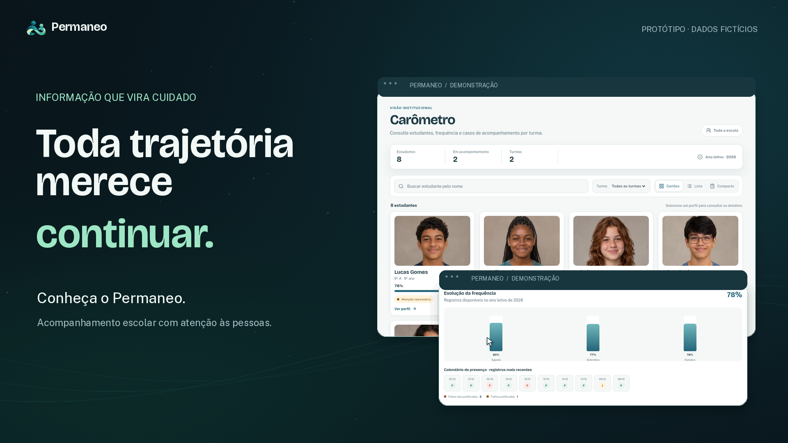

# Permaneo — Cinematic Launch

Comercial de **88 segundos**, com navegação capturada do protótipo real, locução masculina sintética em português brasileiro, trilha eletrônica original, efeitos e legendas. Há duas composições: 1920 × 1080 e 1080 × 1920, ambas a 30 fps, H.264/AAC.

## Assistir e baixar

- [MP4 horizontal — 1920 × 1080](deliverables/permaneo-cinematic-launch-1080p.mp4)
- [MP4 vertical — 1080 × 1920](deliverables/permaneo-cinematic-launch-vertical.mp4)
- [Locução masculina WAV](deliverables/permaneo-narracao-masculina.wav)
- [Trilha original WAV](deliverables/permaneo-trilha.wav)
- [Legendas SRT](deliverables/permaneo-legendas.srt)
- [Miniatura](deliverables/permaneo-thumbnail.png)
- [Validação técnica](VALIDACAO.md)

No GitHub, abra o arquivo e use **Download raw file** para baixar o MP4.




## O que foi verificado

Fonte: https://github.com/PermaneoOFC/demo-repository

Commit auditado: `a0bebcdb8d1c3216e80635c48d6a7066f67de387`.

O README e PRODUCT.md do repositório identificam o produto como **protótipo demonstrativo**. O filme mantém a indicação “PROTÓTIPO · DADOS FICTÍCIOS” em todos os quadros e a locução também informa a condição demonstrativa. A disponibilidade em produção não é afirmada.

Foram usados o acesso oficial **Explorar sem preencher**, os três perfis de demonstração e os dados fictícios já fornecidos pelo projeto. As observações e o acompanhamento criados durante a captura permanecem apenas no navegador isolado. Não houve uso de conta real, envio de mensagens ou acesso a dados de estudantes reais.

A jornada principal é home → login demonstrativo → painel → filtro da turma 9º A → Lucas Gomes → frequência → desempenho → observação → acompanhamento. A montagem complementar mostra Carômetro, relatórios, notificações, Sala Virtual no perfil do professor e atividades no portal do estudante. A troca de perfil na montagem é sinalizada pelos títulos.

## Limitações e decisões editoriais

- `permaneo-comercial-premium.mp4` não foi encontrado na árvore da revisão auditada nem nos arquivos anexados disponíveis. Esta é uma **nova produção**, não uma revisão comparativa daquele arquivo.
- O áudio usa **pt-BR-AntonioNeural**, por meio de `edge-tts`, sem chave de API ou consumo de créditos pagos. É uma voz sintética, não uma gravação de locutor contratado.
- A gravação nativa do Playwright é convertida para 30 fps na edição. Interfaces são capturadas em 1440 × 900; os enquadramentos e textos gráficos são compostos na resolução final de cada vídeo.
- Os enquadramentos são animações editoriais sobre gravações reais. Não representam animações adicionais implementadas no produto.
- Indicadores fictícios pertencem ao contexto de cada tela. Não são resultados reais da plataforma nem evidência de redução de evasão.
- UserWay e VLibras externos foram bloqueados **somente no navegador de captura**, para que a gravação não dependesse da rede. Nenhum arquivo da aplicação foi alterado.
- A página atual de perfil contém datas antigas exibidas como `Invalid Date` na visão geral. O filme concentra a demonstração nas abas funcionais de frequência, desempenho e acompanhamento. A aplicação de produção não foi corrigida ou modificada por este projeto audiovisual.
- As legendas são sincronizadas por frase dentro de cada tomada de voz; não são legendas palavra a palavra.

## Entregáveis

- `permaneo-cinematic-launch-1080p.mp4`: versão principal horizontal.
- `permaneo-cinematic-launch-vertical.mp4`: composição própria para celular, com títulos reorganizados, visão da navegação e recortes de detalhe, sem corte automático do vídeo horizontal.
- `permaneo-narracao-masculina.wav`: voz isolada, alinhada à linha do tempo de 88 s.
- `permaneo-trilha.wav`: composição original isolada.
- `permaneo-efeitos.wav`: efeitos isolados.
- `permaneo-mix.wav`: mix completo em PCM 48 kHz.
- `permaneo-legendas.srt`: legendas em português.
- `permaneo-thumbnail.png`: miniatura 1920 × 1080.
- `VALIDACAO.md` e `validation.json`: inspeção técnica dos arquivos finais.

Os MP4s contêm legendas visuais incorporadas à imagem e também uma faixa de legendas selecionável. Desative a faixa selecionável no player se ele estiver exibindo duas legendas.

## Projeto editável

- `scenes.json`: títulos, tempos, enquadramentos e detalhes de cada cena.
- `render.py`: animação determinística quadro a quadro, tipografia, identidade, câmeras e composição das duas proporções.
- `capture.py`: navegação real automatizada com Playwright; mantém registro de tempos e verifica erros.
- `capture_room.py`: tomada complementar da Sala Virtual, com a planta completa visível.
- `edit.py`: cortes e ajuste de duração das gravações.
- `narration.py`: sete falas sintetizadas separadamente.
- `audio_mix.py`: sintetizadores, arranjo original a 112,5 BPM, efeitos, ducking e tratamento da voz.
- `thumbnail.py`: composição da miniatura.
- `assets/`: símbolo oficial em SVG/PNG, Public Sans e Bricolage Grotesque, extraídos do repositório.
- `captures/`: gravações reais, cortes, imagens e metadados de captura.
- `audio/`: tomadas de voz, tempos e legendas de trabalho.

## Renderizar com as mídias incluídas

Requisitos: Python 3.11+, FFmpeg/FFprobe no PATH. Instale as bibliotecas em um ambiente virtual de sua preferência:

```bash
python -m pip install -r requirements.txt
python render.py --preview 3 11 29 43.5 51 69 85
python render.py --format vertical --preview 3 21 41 51 82
python render.py --format horizontal
python render.py --format vertical
python thumbnail.py
```

Os arquivos são gerados em `deliverables/`. As tomadas de voz e as gravações incluídas permitem renderizar novamente **sem acessar o serviço de voz ou o site original**.

Para alterar texto gráfico, edite `scenes.json`. Para alterar apenas enquadramentos, ajuste `crop` e `focus`, em coordenadas da captura 1440 × 900. Os enquadramentos preservam a proporção das imagens. A edição de duração exige manter `start`/`end` contíguos, atualizar a duração geral em `render.py` e `audio_mix.py`, e gerar novamente a montagem com `edit.py`.

Para alterar a locução, edite `LINES` em `narration.py`, remova apenas os `audio/voice-N.mp3` correspondentes e execute:

```bash
python narration.py
python audio_mix.py
python render.py --format horizontal
python render.py --format vertical
```

A geração de voz exige conexão com o serviço utilizado. As falas prontas estão incluídas. `narration.py` respeita HTTPS_PROXY quando configurado e mantém a verificação TLS.

## Recapturar a plataforma

Clone o repositório e faça checkout do commit auditado em uma cópia isolada. Em `permaneo-app`, execute `npm ci` e `npm run dev -- --host 127.0.0.1`. Os scripts esperam a aplicação em `http://127.0.0.1:5173` e Chromium em `/usr/bin/chromium`; adapte o caminho de Chromium se necessário. `capture.py` aceita `PERMANEO_URL`.

Instale o FFmpeg de captura do Playwright em uma pasta gravável e use a mesma variável nas capturas:

```bash
PLAYWRIGHT_BROWSERS_PATH=.playwright python -m playwright install ffmpeg
PLAYWRIGHT_BROWSERS_PATH=.playwright python capture.py
PLAYWRIGHT_BROWSERS_PATH=.playwright python capture_room.py
python edit.py
```

Revise as capturas após qualquer atualização do produto: seletores, rotas e dados demonstrativos podem mudar. Nenhum login de produção é necessário.

## Recursos e autoria

A música e os efeitos foram compostos programaticamente para esta peça, sem gravações musicais de terceiros, loops comerciais ou samples protegidos. A identidade e as mídias da interface vêm do repositório indicado pelo solicitante. Os retratos são personagens fictícios, conforme `public/images/estudantes/README.md` do projeto. As fontes são os arquivos oficiais incluídos pelo projeto. A voz depende das condições do serviço Microsoft utilizado; este pacote não declara uma licença adicional para esse serviço.

Nenhum arquivo da aplicação de produção foi alterado. A entrega usa uma branch temporária de revisão. Nenhum commit foi feito na `main`. Nenhuma publicação em redes sociais ou compra foi realizada.
